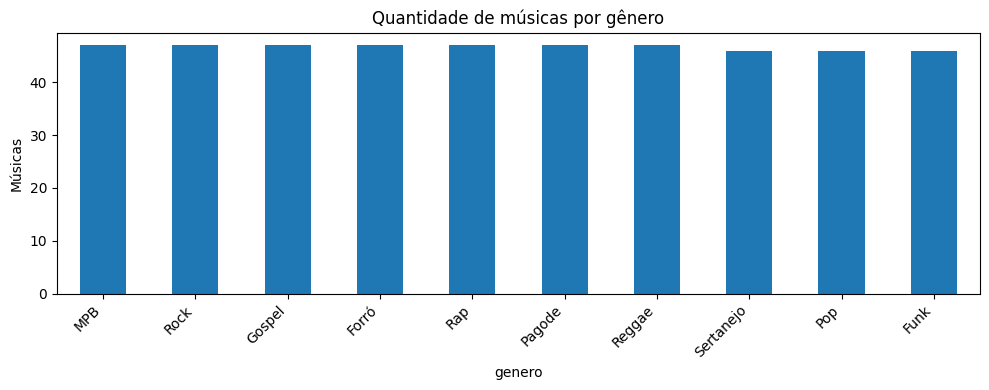
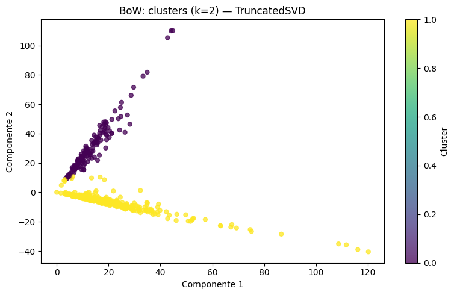
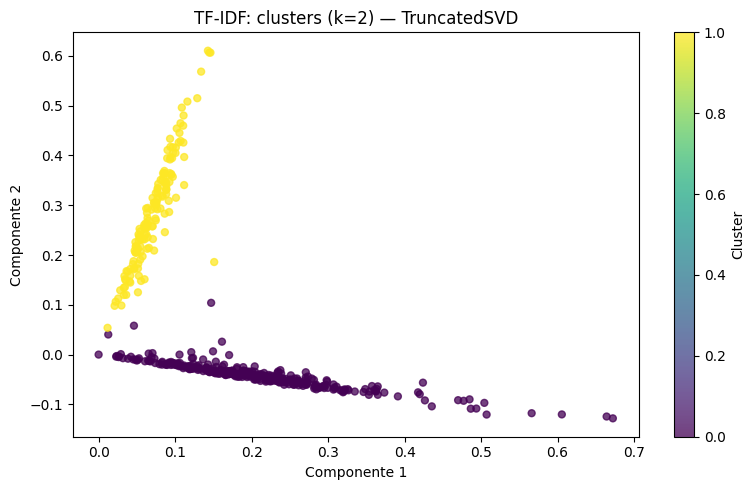
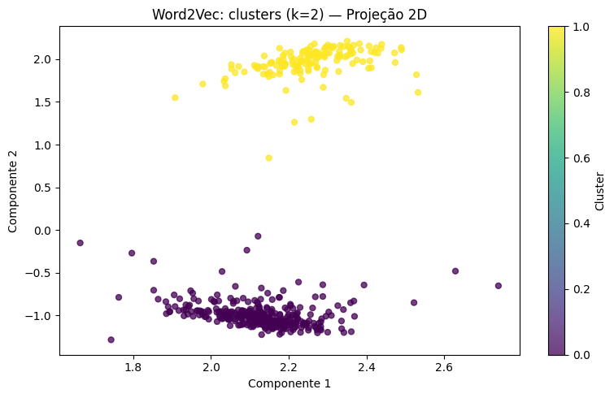
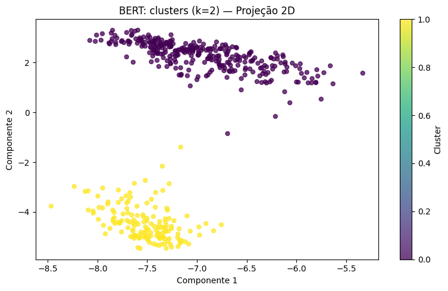
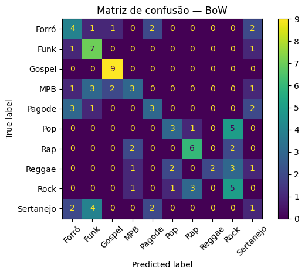
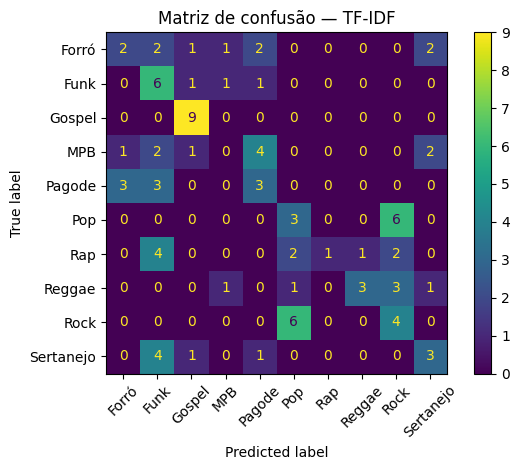
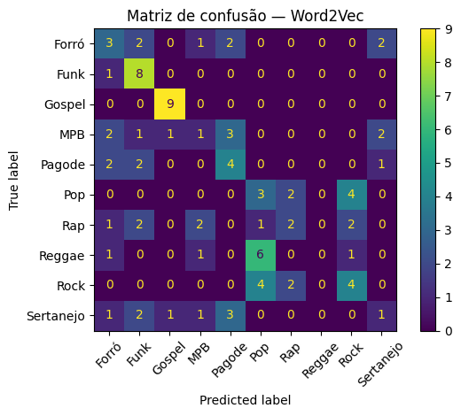
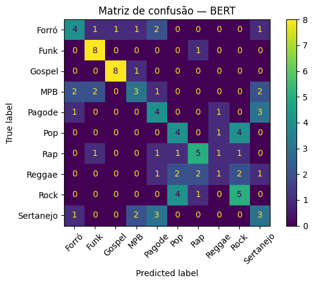

# PLN 2026/2 — Trabalho da Unidade 3

**Universidade Regional de Blumenau — Centro de Ciências Exatas e Naturais — Curso de Ciência da Computação**
**Disciplina:** Processamento de Linguagem Natural
**Equipe:** Bruno Cardoso
**Tema (Unidade 1):** letras e significado de músicas; recomendação de músicas com base no significado das letras.

Este trabalho avalia a combinação de diferentes representações textuais (BoW, TF-IDF, Word2Vec e BERT) com tarefas de PLN (clusterização, busca, classificação, análise de sentimento, reconhecimento de entidades nomeadas e extração de relações), usando o corpus de letras de música coletado no Trabalho 1.

## Sumário

- [Estrutura da pasta](#estrutura-da-pasta)
- [Como reproduzir](#como-reproduzir)
- [Dados, configuração e amostragens](#dados-configuração-e-amostragens)
- [1) Atividades realizadas](#1-atividades-realizadas)
- [2) Clusterização](#2-clusterização-qual-representação-e-qual-número-de-clusters)
- [3) Busca e recomendação](#3-busca-e-recomendação)
- [4) Classificação](#4-classificação)
- [5) Sentimento, entidades nomeadas e relações](#5-sentimento-entidades-nomeadas-e-relações)
- [6) Relação com o projeto da Unidade 1](#6-relação-com-o-projeto-da-unidade-1)
- [Uso de IA generativa](#uso-de-ia-generativa)

## Estrutura da pasta

```text
Unidade_3/
├── README.md                                          # este relatório
├── PLN_Trabalho_Unidade_3_Notebook_Integrado.ipynb    # código completo, executado, com as saídas
├── codigo/
│   └── verificacao_idioma_clusters.py                 # verificação complementar da Q2 (idioma x clusters)
├── imagens/                                           # figuras exibidas neste README
│   ├── fig01_distribuicao_generos.png
│   ├── fig02_clusters_bow_k2.png
│   ├── fig03_clusters_tfidf_k2.png
│   ├── fig04_clusters_word2vec_k2.png
│   ├── fig05_clusters_bert_k2.png
│   ├── fig06_confusao_bow.png
│   ├── fig07_confusao_tfidf.png
│   ├── fig08_confusao_word2vec.png
│   └── fig09_confusao_bert.png
└── resultados_trabalho_unidade3/                      # tabelas geradas pelo notebook (seção 10)
    ├── corpus_preparado.csv
    ├── metricas_clusterizacao.csv
    ├── metricas_classificacao.csv
    ├── analise_sentimentos.csv
    ├── entidades_nomeadas.csv
    ├── relacoes_extraidas.csv
    └── verificacao_idioma_clusters.txt                # saída do script em codigo/
```

## Como reproduzir

1. Coloque o arquivo `dataset_musicas_preprocessado.json` (gerado no Trabalho 1) na mesma pasta do notebook. <!-- PREENCHER: link para a pasta do Trabalho 1 no repositório -->
2. Abra o notebook no Google Colab ou no Jupyter e execute as células em ordem. A primeira célula instala `gensim transformers torch spacy seaborn` e baixa o modelo `pt_core_news_sm` do spaCy; a seção 8 instala o `pysentimiento`. O BERT (`neuralmind/bert-base-portuguese-cased`) é baixado da internet na primeira execução.
3. Ao final, o notebook grava os CSVs na pasta `resultados_trabalho_unidade3/`.
4. Para reproduzir a verificação de idioma da Questão 2 (a partir da pasta `Unidade_3/`, depois de ter o `corpus_preparado.csv`):

```bash
pip install pandas numpy scikit-learn
python codigo/verificacao_idioma_clusters.py
```

## Dados, configuração e amostragens

- **Corpus:** 467 músicas de 10 gêneros (46 a 47 por gênero), coletadas do letras.mus.br no Trabalho 1. A coluna de gênero vem do ranking do site (`genero_ranking`), e não de uma anotação do conteúdo da letra. Arquivo: [`corpus_preparado.csv`](resultados_trabalho_unidade3/corpus_preparado.csv).
- **BoW e TF-IDF:** unigramas e bigramas, até 30.000 atributos, sem acentos, calculados sobre a coluna `letra` (sem remover stopwords).
- **Word2Vec:** treinado apenas neste corpus (skip-gram, 100 dimensões, janela 5, 30 épocas); cada letra é a média dos vetores das suas palavras.
- **BERT:** `neuralmind/bert-base-portuguese-cased`, sem ajuste fino; média dos vetores dos tokens, com truncamento em 256 tokens por letra.
- **Amostragens (declaradas conforme o enunciado):** a análise de sentimento usou as **100 primeiras** músicas do corpus, com cada letra cortada em 1.500 caracteres; NER e extração de relações usaram as **200 primeiras**. O corpus está ordenado por gênero, então essas amostras não cobrem todos os gêneros (ver seção 5).



*Figura 1 — Quantidade de músicas por gênero no corpus.*

<details>
<summary>Código das representações (trechos do notebook)</summary>

```python
# BoW e TF-IDF
bow_vectorizer = CountVectorizer(
    lowercase=True, strip_accents="unicode", token_pattern=r"(?u)\b\w\w+\b",
    max_features=30000, ngram_range=(1, 2), min_df=1
)
tfidf_vectorizer = TfidfVectorizer(
    lowercase=True, strip_accents="unicode", token_pattern=r"(?u)\b\w\w+\b",
    max_features=30000, ngram_range=(1, 2), min_df=1, max_df=0.98
)
X_bow = bow_vectorizer.fit_transform(textos)
X_tfidf = tfidf_vectorizer.fit_transform(textos)

# Word2Vec treinado no corpus; letra = média dos vetores das palavras
modelo_w2v = Word2Vec(
    sentences=sentencas, vector_size=100, window=5,
    min_count=1, workers=4, sg=1, seed=RANDOM_STATE, epochs=30
)

# BERT: média dos vetores dos tokens (com máscara de atenção), máx. 256 tokens
resultado = model_bert(**entradas).last_hidden_state
mascara = entradas["attention_mask"].unsqueeze(-1).expand(resultado.size()).float()
soma = (resultado * mascara).sum(1)
denominador = mascara.sum(1).clamp(min=1e-9)
saidas.append((soma / denominador).cpu().numpy())
```

</details>

## 1) Atividades realizadas

| Tarefa | BoW | TF-IDF | Word2Vec | BERT |
|---|:---:|:---:|:---:|:---:|
| Clusterização + PCA e visualização | ✔ | ✔ | ✔ | ✔ |
| Busca e recomendação | ✔ | ✔ | ✔ | ✔ |
| Classificação | ✔ | ✔ | ✔ | ✔ |

| Tarefa | Situação |
|---|---|
| Análise de sentimento | (x) Foi realizada ( ) Não foi realizada |
| Reconhecimento de Entidades Nomeadas | (x) Foi realizado ( ) Não foi realizado |
| Extração de Relações | (x) Foi realizada ( ) Não foi realizada |

Observações:

- Sentimento, NER e relações usam um modelo pré-treinado (pysentimiento) e modelos/regras do spaCy, e não dependem das quatro representações vetoriais.
- A projeção 2D dos clusters usou **TruncatedSVD** (variante do PCA para matrizes esparsas, que não centraliza os dados), e não o PCA do scikit-learn.
<!-- REVISAR: se o enunciado exigir PCA, trocar por sklearn.decomposition.PCA nas matrizes densas (Word2Vec e BERT) ou manter a explicação acima -->

## 2) Clusterização: qual representação e qual número de clusters

Foi aplicado K-Means (`n_init=10`, `random_state=42`) com k = 2, 3, 4, 5, 8 e 10 em cada representação. As figuras abaixo mostram a projeção 2D dos clusters com o k de maior silhouette, que foi **k=2 nas quatro representações**. Tabela completa: [`metricas_clusterizacao.csv`](resultados_trabalho_unidade3/metricas_clusterizacao.csv).

<table>
  <tr>
    <td align="center"><br><sub>Figura 2 — BoW, k=2</sub></td>
    <td align="center"><br><sub>Figura 3 — TF-IDF, k=2</sub></td>
  </tr>
  <tr>
    <td align="center"><br><sub>Figura 4 — Word2Vec, k=2</sub></td>
    <td align="center"><br><sub>Figura 5 — BERT, k=2</sub></td>
  </tr>
</table>

### Métricas intra e intercluster

**Silhouette (cosseno) — maior é melhor**

| Representação | k=2 | k=3 | k=4 | k=5 | k=8 | k=10 |
|---|---:|---:|---:|---:|---:|---:|
| BoW | 0,18 | -0,03 | -0,10 | -0,09 | -0,12 | -0,19 |
| TF-IDF | 0,05 | 0,03 | 0,01 | 0,03 | 0,00 | 0,00 |
| Word2Vec | 0,81 | 0,50 | 0,36 | 0,33 | 0,12 | 0,13 |
| BERT | 0,69 | 0,45 | 0,39 | 0,23 | 0,15 | 0,12 |

**Davies-Bouldin — menor é melhor**

| Representação | k=2 | k=3 | k=4 | k=5 | k=8 | k=10 |
|---|---:|---:|---:|---:|---:|---:|
| BoW | 2,07 | 1,86 | 2,00 | 1,99 | 2,33 | 1,95 |
| TF-IDF | 2,96 | 4,33 | 4,83 | 6,02 | 5,15 | 3,98 |
| Word2Vec | 0,59 | 2,35 | 2,55 | 2,27 | 2,74 | 2,49 |
| BERT | 0,79 | 1,86 | 2,16 | 2,53 | 2,44 | 2,63 |

**Calinski-Harabasz — maior é melhor**

| Representação | k=2 | k=3 | k=4 | k=5 | k=8 | k=10 |
|---|---:|---:|---:|---:|---:|---:|
| BoW | 69,0 | 53,3 | 42,9 | 41,6 | 28,1 | 25,6 |
| TF-IDF | 44,4 | 25,3 | 19,3 | 15,1 | 9,8 | 8,4 |
| Word2Vec | 933,0 | 503,9 | 353,8 | 272,0 | 168,1 | 135,7 |
| BERT | 518,8 | 294,3 | 222,2 | 174,3 | 117,8 | 96,0 |

- **Silhouette** compara, para cada música, a distância média aos documentos do próprio cluster (coesão intracluster) com a distância ao cluster vizinho mais próximo (separação intercluster). Em k=2: Word2Vec 0,81; BERT 0,69; BoW 0,18; TF-IDF 0,05.
- **Davies-Bouldin** é a razão entre a dispersão interna dos clusters e a distância entre seus centróides. Em k=2: Word2Vec 0,59; BERT 0,79; BoW 2,07; TF-IDF 2,96.
- **Calinski-Harabasz** é a razão entre a dispersão intercluster e a intracluster. Em k=2: Word2Vec 933; BERT 519; BoW 69; TF-IDF 44.
- O Calinski-Harabasz cai a cada aumento de k nas quatro representações, e o silhouette cai de forma geral. No BoW o silhouette fica negativo a partir de k=3, ou seja, as músicas estão em média mais próximas de outro cluster do que do próprio. No TF-IDF ele fica próximo de zero em todos os k. Isso indica clusters sobrepostos, sem estrutura bem definida.
- Davies-Bouldin e Calinski-Harabasz não são diretamente comparáveis entre representações: no código, BoW e TF-IDF foram avaliados após redução a 100 componentes por SVD, Word2Vec em 100 dimensões e BERT em 768.

### Leitura qualitativa dos clusters

Com k=2, os termos mais frequentes dos clusters de BoW e TF-IDF mostram que a separação é **por idioma**: um cluster tem termos como “you, the, and, me, it, to, my, in” e o outro “que, eu, de, nao, voce, pra, se”. Os primeiros exemplos do cluster em inglês são Training Season, Ordinary e Die With A Smile (todas Pop); os do outro são Peão Todo Tatuado, Evidências e Te Esperando (todas Sertanejo).

Para confirmar, as partições de BoW e TF-IDF foram reproduzidas com as mesmas configurações do notebook (os tamanhos coincidem: 141/326 e 318/149) e cruzadas com o idioma de cada letra. O idioma foi estimado por uma heurística simples, que compara a contagem de palavras funcionais do inglês e do português; **não há rótulo de idioma verificado manualmente**. Script: [`codigo/verificacao_idioma_clusters.py`](codigo/verificacao_idioma_clusters.py). Saída completa: [`verificacao_idioma_clusters.txt`](resultados_trabalho_unidade3/verificacao_idioma_clusters.txt).

| Representação | Cluster | Músicas | Em inglês (heurística) | Em português (heurística) |
|---|---:|---:|---:|---:|
| BoW | 0 | 141 | 141 | 0 |
| BoW | 1 | 326 | 14 | 312 |
| TF-IDF | 0 | 318 | 6 | 312 |
| TF-IDF | 1 | 149 | 149 | 0 |

<details>
<summary>Heurística de idioma usada</summary>

```python
PALAVRAS_EN = {"the", "you", "and", "my", "to", "it", "in", "that", "me", "i", "is", "your", "of"}
PALAVRAS_PT = {"que", "eu", "nao", "de", "voce", "pra", "se", "te",
               "um", "uma", "com", "por", "meu", "minha", "mais"}

def idioma(txt):
    palavras = re.findall(r"[a-z]+", normalizar(txt))   # minúsculas, sem acentos
    en = sum(p in PALAVRAS_EN for p in palavras)
    pt = sum(p in PALAVRAS_PT for p in palavras)
    return "EN" if en > pt else "PT"
```

</details>

Pela mesma heurística, o corpus tem 312 músicas em português e 155 em inglês. Pop (44 de 46) e Rock (45 de 47) são quase todos em inglês, e Rap e Reggae têm 32 de 47 em inglês cada. <!-- REVISAR: conferir por amostragem manual, principalmente Rap e Reggae -->

Para Word2Vec e BERT, os clusters de k=2 têm 316 e 151 músicas, e os primeiros exemplos de cada cluster são os mesmos do BoW (Sertanejo no maior, Pop no menor). Isso é coerente com separação por idioma, mas **essa verificação não foi feita para essas duas representações**. <!-- ATUALIZAR: cruzar labels_cluster["Word2Vec"] e labels_cluster["BERT"] com o idioma no notebook e reescrever este parágrafo com o resultado -->

Como medida complementar, a pureza por gênero com k=10 foi de 0,27 no BoW e 0,27 no TF-IDF (soma das maiores contagens de um mesmo gênero em cada cluster, dividida por 467). Não foi calculada para Word2Vec e BERT, e ARI/NMI contra os gêneros também não foram calculados.

<details>
<summary>Código da clusterização e das métricas (trecho do notebook)</summary>

```python
def clusterizar_e_avaliar(X, nome, ks=(2,3,4,5,8,10)):
    resultados = []
    n = X.shape[0]
    for k in ks:
        if k >= n or k < 2:
            continue
        km = KMeans(n_clusters=k, random_state=RANDOM_STATE, n_init=10)
        labels = km.fit_predict(X)
        amostra = min(n, 2000)
        sil = silhouette_score(X, labels, metric="cosine", sample_size=amostra,
                               random_state=RANDOM_STATE)
        X_eval = X.toarray() if hasattr(X, "toarray") else X
        if X_eval.shape[1] > 3000:   # BoW/TF-IDF: reduz a 100 componentes antes de DB e CH
            X_eval = TruncatedSVD(n_components=min(100, X_eval.shape[1]-1),
                                  random_state=RANDOM_STATE).fit_transform(X)
        db = davies_bouldin_score(X_eval, labels)
        ch = calinski_harabasz_score(X_eval, labels)
        resultados.append({"representação": nome, "k": k, "silhouette_coseno": sil,
                           "davies_bouldin": db, "calinski_harabasz": ch})
    return pd.DataFrame(resultados)
```

</details>

### Conclusão da questão 2

Pelas métricas, **Word2Vec e, em seguida, BERT** produziram os clusters mais coesos e separados, sempre com **k=2**. Mas o que esses dois clusters capturam é, ao menos nos casos verificados (BoW e TF-IDF), o idioma da letra, e não o tema nem o gênero. Nenhum dos k testados recuperou os 10 gêneros do corpus. Assim, k=2 é o melhor valor numericamente, mas não expressa as características originais dos dados.

Uma hipótese, não testada, para os valores muito altos do Word2Vec: o modelo foi treinado em apenas 467 letras de dois idiomas, e vocabulários quase disjuntos geram dois grupos muito separados quando os vetores são médias das palavras. Para obter agrupamentos temáticos seria preciso separar ou normalizar por idioma, por exemplo analisando só as letras em português.

## 3) Busca e recomendação

Para cada representação, a consulta é vetorizada e comparada com as 467 letras por similaridade de cosseno. Foram usadas três consultas em português. As tabelas mostram os cinco primeiros resultados (os três primeiros formam o top-3), com o gênero entre parênteses. Os valores de similaridade não são comparáveis entre representações, então só a ordem é analisada. As saídas completas (similaridade e trecho de 220 caracteres de cada letra) estão na seção 6 do [notebook](PLN_Trabalho_Unidade_3_Notebook_Integrado.ipynb).

<details>
<summary>Código da busca (trecho do notebook)</summary>

```python
def buscar(consulta, nome, k=5):
    X = representacoes[nome]
    q = representar_consulta(consulta, nome)      # vetoriza a consulta com a mesma representação
    sims = cosine_similarity(q, X).ravel()
    ordem = np.argsort(sims)[::-1][:k]
    return pd.DataFrame({
        "posição": np.arange(1, len(ordem)+1),
        "similaridade": sims[ordem],
        "titulo": df.iloc[ordem]["titulo"].values,
        "artista": df.iloc[ordem]["artista"].values,
        "gênero": df.iloc[ordem]["genero"].values,
        "trecho": df.iloc[ordem]["letra"].str.replace("\n", " ", regex=False).str.slice(0, 220).values
    })

CONSULTAS = [
    "saudade de um amor que acabou",
    "dançar na festa com os amigos",
    "fé em Deus e esperança",
]
```

</details>

**Consulta 1: “saudade de um amor que acabou”**

| # | BoW | TF-IDF | Word2Vec | BERT |
|---|---|---|---|---|
| 1 | Flor E O Beija-Flor (Sertanejo) | Seja Para Mim (Reggae) | Flor E O Beija-Flor (Sertanejo) | Tu Mandas No Meu Coração (Pagode) |
| 2 | COMO É QUE FALA DE AMOR? (Sertanejo) | Flor E O Beija-Flor (Sertanejo) | COMO É QUE FALA DE AMOR? (Sertanejo) | La Mour (Agamenon) (Forró) |
| 3 | Seja Para Mim (Reggae) | La Mour (Agamenon) (Forró) | Defeito Meu (Pagode) | Girassol (Rap) |
| 4 | La Mour (Agamenon) (Forró) | Defeito Meu (Pagode) | É Tarde Demais (Pagode) | Displicente (Forró) |
| 5 | É Tarde Demais (Pagode) | É Tarde Demais (Pagode) | Dependente (Pagode) | Fim de Noite (Pagode) |

**Consulta 2: “dançar na festa com os amigos”**

| # | BoW | TF-IDF | Word2Vec | BERT |
|---|---|---|---|---|
| 1 | Ainda Bem (MPB) | Voando Pro Pará (Forró) | Voando Pro Pará (Forró) | Era Uma Vez (Poesia Acústica #6) (Rap) |
| 2 | Gnarly (Pop) | LET’S GO 4 (Funk) | Te Esperando (Sertanejo) | Laço na Fivela (Funk) |
| 3 | Os Guerreiros Se Preparam - 212 (Gospel) | Não Sei Dançar (MPB) | Vida Loka, Pt. 1 (Rap) | Set Boca de 09 / Mostra Esses Peito… (Funk) |
| 4 | LET’S GO 4 (Funk) | Vida Loka, Pt. 1 (Rap) | Laço na Fivela (Funk) | Cuida do Pet (Funk) |
| 5 | Ta Pedindo Toma (Funk) | Laço na Fivela (Funk) | A Praia (Forró) | GRWM (Funk) |

**Consulta 3: “fé em Deus e esperança”**

| # | BoW | TF-IDF | Word2Vec | BERT |
|---|---|---|---|---|
| 1 | A Alma Abatida - 193 (Gospel) | A Alma Abatida - 193 (Gospel) | A Alma Abatida - 193 (Gospel) | Toda Bíblia É Comunicação (Gospel) |
| 2 | Toda Bíblia É Comunicação (Gospel) | Selado Na Luz (Reggae) | Agindo Diferente (Gospel) | Ó Desce Fogo Santo - 5 (Gospel) |
| 3 | Clareou (Pagode) | Toda Bíblia É Comunicação (Gospel) | Selado Na Luz (Reggae) | Porque Ele Vive - 545 (Gospel) |
| 4 | Bondade de Deus (Gospel) | Clareou (Pagode) | Toda Bíblia É Comunicação (Gospel) | Campeões da luz - 305 (Gospel) |
| 5 | Ó Desce Fogo Santo - 5 (Gospel) | Vida Loka, Pt. 1 (Rap) | Odres Novos (Gospel) | Firme nas Promessas - 107 (Gospel) |

### Análise crítica

- **A consulta 3 (vocabulário religioso explícito) foi a melhor.** Pelo rótulo de gênero, o BERT retornou 5 músicas Gospel em 5; BoW e Word2Vec, 4 em 5; TF-IDF, 2 em 5. O rótulo vem do ranking do site e não mede relevância: “Selado Na Luz” está como Reggae, mas o trecho mostrado pelo notebook tem teor religioso, e “Vida Loka, Pt. 1” (Rap), no top-5 do TF-IDF, não tem relação visível com a consulta.
- **Consulta 1:** BoW e TF-IDF compartilham 4 dos 5 resultados; Word2Vec compartilha 3 com o BoW; o BERT coincide com os demais em apenas um título (La Mour). Os trechos de “Girassol” e “Displicente”, do BERT, citam “saudade” literalmente. Os resultados cobrem Sertanejo, Pagode, Forró, Reggae e Rap, o que é esperado numa consulta temática. <!-- REVISAR: ler as letras e anotar, para cada top-3 e top-5, relevante / parcialmente relevante / irrelevante -->
- **A consulta 2 (abstrata, com várias palavras comuns) teve resultados heterogêneos.** No BoW, o 1º lugar é “Ainda Bem” (MPB), cujo trecho fala de encontrar alguém, e o 3º é um hino do gênero Gospel, sem relação aparente com festa. Uma hipótese, não testada, é que palavras frequentes da consulta (“na”, “com”, “os”) pesem na correspondência. TF-IDF e Word2Vec colocam “Voando Pro Pará” em 1º (trecho: “Dançar, curtir, ficar…”), claramente alinhada. No BERT, 4 dos 5 são Funk, mas o 1º (“Era Uma Vez (Poesia Acústica #6)”) tem um trecho sem sinal de festa.
- **Não há avaliação quantitativa.** Não existe gabarito de relevância, e precisão@3, precisão@5 e nDCG não foram calculadas. Só 3 consultas foram testadas.

### Os resultados são utilizáveis em um contexto real?

Só parcialmente. Como protótipo, a busca funciona razoavelmente quando a consulta tem vocabulário temático explícito (consulta 3), especialmente com BERT. Para consultas abstratas ou coloquiais (consulta 2) os resultados são instáveis. Limitações do estado atual: corpus pequeno (467 letras), letras em inglês e português indexadas juntas, BERT truncado em 256 tokens (o fim de letras longas é ignorado) e nenhuma limpeza de stopwords na consulta.

**Melhorias possíveis (propostas, não executadas):** combinar os rankings lexical (BoW/TF-IDF) e semântico (BERT) por rank fusion; remover stopwords da consulta; indexar por estrofe em vez de letra inteira; usar embeddings de sentenças multilíngues; filtrar por idioma ou gênero; e montar um pequeno conjunto de consultas com relevância anotada à mão para medir precisão@k.

## 4) Classificação

Foi possível treinar um classificador de **gênero** (10 classes) para cada representação. Usou-se Regressão Logística (`class_weight="balanced"`, `max_iter=1500`) com divisão estratificada 80/20: 373 músicas de treino e 94 de teste, a mesma divisão para as quatro representações. Com 10 classes equilibradas, o acaso daria cerca de 10% de acurácia. Tabela completa: [`metricas_classificacao.csv`](resultados_trabalho_unidade3/metricas_classificacao.csv).

<details>
<summary>Código da classificação (trecho do notebook)</summary>

```python
X_train_idx, X_test_idx = train_test_split(
    indices, test_size=0.2, random_state=RANDOM_STATE,
    stratify=df_clf["genero"]
)
for nome in representacoes:
    Xtr = matriz_subset(nome, X_train_idx)
    Xte = matriz_subset(nome, X_test_idx)
    modelo = LogisticRegression(max_iter=1500, class_weight="balanced",
                                random_state=RANDOM_STATE)
    modelo.fit(Xtr, y_train)
    pred = modelo.predict(Xte)
    p, r, f1, _ = precision_recall_fscore_support(
        y_test, pred, average="macro", zero_division=0
    )
```

</details>

| Representação | Acurácia | Precisão macro | Revocação macro | F1 macro |
|---|---:|---:|---:|---:|
| BERT | 0,479 | 0,470 | 0,481 | 0,468 |
| BoW | 0,457 | 0,497 | 0,458 | 0,441 |
| TF-IDF | 0,362 | 0,423 | 0,370 | 0,337 |
| Word2Vec | 0,372 | 0,314 | 0,378 | 0,333 |

*Métricas no conjunto de teste (94 músicas).*

| Gênero (F1) | BoW | TF-IDF | Word2Vec | BERT |
|---|---:|---:|---:|---:|
| Forró | 0,38 | 0,25 | 0,29 | 0,44 |
| Funk | 0,56 | 0,40 | 0,62 | 0,76 |
| Gospel | 0,86 | 0,82 | 0,90 | 0,89 |
| MPB | 0,35 | 0,00 | 0,12 | 0,35 |
| Pagode | 0,38 | 0,30 | 0,38 | 0,38 |
| Pop | 0,40 | 0,29 | 0,26 | 0,40 |
| Rap | 0,60 | 0,18 | 0,25 | 0,53 |
| Reggae | 0,36 | 0,46 | 0,00 | 0,15 |
| Rock | 0,40 | 0,32 | 0,38 | 0,45 |
| Sertanejo | 0,12 | 0,35 | 0,13 | 0,32 |

*F1 por gênero no conjunto de teste (9 a 10 músicas por gênero).*

<table>
  <tr>
    <td align="center"><br><sub>Figura 6 — Matriz de confusão, BoW</sub></td>
    <td align="center"><br><sub>Figura 7 — Matriz de confusão, TF-IDF</sub></td>
  </tr>
  <tr>
    <td align="center"><br><sub>Figura 8 — Matriz de confusão, Word2Vec</sub></td>
    <td align="center"><br><sub>Figura 9 — Matriz de confusão, BERT</sub></td>
  </tr>
</table>

### Análise

- **Representação mais precisa:** o BERT teve a maior acurácia (0,479) e o maior F1 macro (0,468), seguido de perto pelo BoW (0,457 e 0,441). A diferença entre os dois é de cerca de 2 músicas em 94, então não dá para afirmar superioridade. TF-IDF e Word2Vec ficaram em torno de 0,36 a 0,37.
- **Gospel é o gênero mais fácil** em todas as representações (F1 de 0,82 a 0,90), coerente com o vocabulário religioso próprio. Funk também é relativamente bem reconhecido (até 0,76 no BERT). Os mais difíceis variam: Sertanejo (0,12 a 0,35), MPB (0,00 a 0,35) e Reggae (0,00 a 0,46). No BoW, Reggae teve precisão 1,00 e revocação 0,22: quase não foi previsto, mas acertou quando foi.
- **Dados novos:** o melhor modelo (BERT) classificou três frases curtas escritas no notebook.

  | Texto novo | Gênero previsto (BERT) |
  |---|---|
  | Deus me dá força e esperança, eu sigo com fé no coração. | Rap |
  | Saudade da pessoa amada, lembro do beijo e do nosso amor. | Forró |
  | A festa começou, vamos dançar e cantar até amanhecer. | Forró |

  A frase religiosa foi para Rap, embora Gospel seja a classe mais fácil no teste, o que sugere que o modelo generaliza mal para textos curtos fora do formato de letras completas. Com apenas 3 exemplos, isso é só um indício.
- **Modelos usados:** o BERT (modelo de linguagem pré-treinado em português) foi usado só como extrator de características, sem ajuste fino. O classificador é sempre a Regressão Logística, um modelo linear. Não foram testados modelos de decisão (árvores, Random Forest, boosting).
- **Limitações:** divisão única, sem validação cruzada; conjunto de teste de 94 músicas; BoW, TF-IDF e Word2Vec foram ajustados no corpus inteiro antes da divisão (vazamento leve de vocabulário/IDF para o teste); o gênero vem do ranking do site; e há letras em inglês processadas por um BERT em português.

## 5) Sentimento, entidades nomeadas e relações

As três técnicas **são aplicáveis** ao corpus e rodaram sem erro, mas os resultados atuais têm qualidade limitada, como mostram os itens a seguir. Nenhuma das saídas foi auditada manualmente. <!-- REVISAR: auditar 20 a 30 linhas de cada tarefa e reportar a taxa de acerto -->

### 5.1 Análise de sentimento

Foi usado o analisador de sentimento da biblioteca `pysentimiento` para português (classes NEG, NEU, POS), sem ajuste ao domínio de letras. A amostra foi formada pelas 100 primeiras músicas do corpus, com no máximo 1.500 caracteres cada (média de 1.298): 46 Sertanejo, 46 Pop e 8 Rock. Resultados: [`analise_sentimentos.csv`](resultados_trabalho_unidade3/analise_sentimentos.csv).

```python
from pysentimiento import create_analyzer
analisador_sentimento = create_analyzer(task="sentiment", lang="pt")
amostra_sent = df.head(min(100, len(df))).copy()
for _, row in amostra_sent.iterrows():
    trecho = row["letra"][:1500]
    res = analisador_sentimento.predict(trecho)
```

| Resultado | NEG | NEU | POS |
|---|---:|---:|---:|
| Músicas (de 100) | 0 | 98 | 2 |
| Probabilidade média | 0,089 | 0,732 | 0,179 |

As duas músicas positivas são “Na Linha do Tempo” (Victor & Leo) e “Ela É Demais” (Rick & Renner), ambas Sertanejo. As 46 músicas Pop saíram todas neutras. “Evidências”, por exemplo, foi classificada como neutra (probabilidade 0,72), apesar de falar de amor e medo de se entregar. O resultado praticamente não discrimina as músicas. Duas hipóteses, não testadas: o modelo não foi feito para linguagem poética ou irônica, e a maior parte das letras Pop está em inglês (pela heurística da seção 2), enquanto o modelo é para português. Além disso, a amostra só cobre 3 gêneros.

### 5.2 Reconhecimento de entidades nomeadas (NER)

Foi usado o spaCy com o modelo `pt_core_news_sm` nas 200 primeiras músicas (199 tiveram ao menos uma entidade; a amostra cobre 5 gêneros: Pop, Rock, MPB, Funk e Sertanejo). Foram encontradas 6.149 entidades (cerca de 31 por música): MISC 3.694 (60,1%), PER 1.419 (23,1%), LOC 691 (11,2%) e ORG 345 (5,6%). A contagem não é de entidades únicas: refrões repetem a mesma ocorrência. Resultados: [`entidades_nomeadas.csv`](resultados_trabalho_unidade3/entidades_nomeadas.csv).

```python
nlp = spacy.load("pt_core_news_sm")
N_MUSICAS_NER = min(200, len(df))
docs_ner = list(nlp.pipe(df.iloc[:N_MUSICAS_NER]["letra"].tolist(), batch_size=16))
for i, doc in enumerate(docs_ner):
    for ent in doc.ents:
        ...  # guarda título, gênero, entidade e categoria
```

| Categoria | Entidades mais frequentes (ocorrências) |
|---|---|
| PER | Pra (37), Baby (29), Tô (25), Pai (23), Hootie (22), Sabe (16) |
| LOC | Vou (26), go (18), uh (15), Quero (14), Lua (12), Gabriela (12) |
| ORG | Cause (24), Ah (15), ParaFAL (12), yeah (11), yes (10), BYD (10) |
| MISC | yeah (70), Yeah (51), I (50), Me (40), We (33), ooh (32) |

A maior parte do que aparece entre as mais frequentes são interjeições, pronomes, verbos e palavras comuns em inglês ou português (“Pra”, “Vou”, “yeah”, “Cause”), ou seja, falsos positivos. Alguns itens podem ser nomes reais (por exemplo “Gabriela”, “Lua”, “BYD”), mas isso não foi verificado. O modelo é para português, e as letras misturam inglês, gírias, abreviações (“Tô”, “Cê”) e versos iniciados com letra maiúscula.

### 5.3 Extração de relações

As relações (sujeito, verbo, objeto) foram extraídas por regras sobre a análise de dependência do spaCy, **verso a verso** (cada linha da letra é analisada separadamente), nas mesmas 200 músicas do NER. Resultados: [`relacoes_extraidas.csv`](resultados_trabalho_unidade3/relacoes_extraidas.csv).

```python
def extrair_svo(texto):
    doc = nlp(texto)
    saida = []
    for verbo in doc:
        if verbo.pos_ not in ("VERB", "AUX"):
            continue
        sujeitos = [t for t in verbo.children if t.dep_ in ("nsubj", "nsubj:pass", "csubj")]
        objetos = [t for t in verbo.children if t.dep_ in ("obj", "dobj", "iobj", "obl", "attr", "oprd")]
        for s in sujeitos:
            for o in objetos:
                saida.append({"sujeito": sintagma(s), "relação": verbo.lemma_,
                              "objeto": sintagma(o), "verso": texto})
    return saida
```

Saíram 2.498 linhas de 192 músicas; 993 são duplicatas exatas (versos repetidos nos refrões), restando 1.505 relações distintas. Entre as distintas, os sujeitos mais comuns são “eu” (198), “que” (78), “você” (48), “ela” (43) e “you” (43); os verbos mais comuns são fazer (47), ter (45) e querer (38).

| Sujeito | Relação | Objeto | Avaliação (por leitura) |
|---|---|---|---|
| eu | querer | te | Correta |
| Eu | entregar | a minha vida | Correta |
| você | cair | na minha cantada | Correta |
| que | ter | saudade | Sujeito é pronome relativo (erro) |
| so that | shitr | helps | Inglês analisado como português (erro) |
| bloodstream you | triedr | so | Inglês analisado como português (erro) |

*Exemplos de relações extraídas; a coluna de avaliação é uma leitura, não uma medida de acerto.*

Quando a letra é em português e tem estrutura de frase, as relações são úteis (“eu querer te”, “eu entregar a minha vida”). Letras em inglês geram verbos inválidos (“shitr”, “triedr”, “therir”), palavras como “never” e “then” aparecem entre os verbos mais frequentes, e versos fragmentados ou com sujeito oculto produzem sujeitos como “que”.

### Resposta resumida

As três técnicas são aplicáveis, e o que se obteve foi: (i) uma distribuição de sentimento quase toda neutra, pouco informativa; (ii) mais de 6 mil entidades, em sua maioria ruído; e (iii) uma base de 1.505 relações distintas, parte delas aproveitável em letras em português. Para uso real, seria preciso tratar o idioma (ou usar modelos multilíngues), amostrar todos os gêneros e validar manualmente.

## 6) Relação com o projeto da Unidade 1

O projeto da Unidade 1 propôs recomendar músicas com base no significado das letras, passando por: classificação por temas e sentimentos (amor, tristeza, superação…), extração de informações (temas, sentimentos, palavras-chave, locais e personalidades), busca de uma música por descrição do usuário e um chatbot. A tabela relaciona cada tarefa com o que foi observado.

| Tarefa da Unidade 1 | O que os resultados mostram |
|---|---|
| Recuperação de informações (buscar por descrição) | É o que está mais perto de funcionar. Com BERT, a consulta temática “fé em Deus e esperança” trouxe 5 de 5 músicas Gospel; consultas abstratas deram resultados instáveis (seção 3). Serve como base para a busca por descrição. |
| Classificação por tema/sentimento | Só foi treinada classificação por gênero (acurácia máxima de 0,48), porque o corpus não tem rótulos de tema ou sentimento. Gênero não equivale a tema, então esse classificador não atende diretamente ao objetivo. Seria preciso rotular um conjunto de músicas por tema. |
| Extração de informações | NER e relações rodam, mas com muito ruído (seção 5). Para locais e personalidades, o modelo atual não é confiável sem filtragem; palavras-chave e temas poderiam vir de TF-IDF ou de clusterização por idioma. |
| Sentimento da letra | O modelo testado quase só devolveu “neutro” (98 de 100), então ainda não ajuda. |
| Chatbot | Não foi testado neste trabalho. |
| Significado da música | O texto usado foi só a letra (as colunas do corpus são título, artista, gênero, letra e texto normalizado). Os “significados” citados como fonte na Unidade 1 não entraram nestas análises. |

As dificuldades previstas na Unidade 1 (linguagem informal e irônica) se confirmaram: gírias e interjeições (“Tô”, “Cê”, “yeah”) viraram falsos positivos de NER, e o modelo de sentimento não distinguiu as músicas. Surgiu também uma dificuldade nova, o **idioma**: o corpus mistura português e inglês, e isso domina a clusterização e prejudica NER, relações e sentimento.

**Conclusão:** as técnicas ajudam, principalmente as representações semânticas (BERT) para busca e recomendação, mas ainda não bastam para o projeto como descrito. Próximos passos sugeridos, não executados: tratar o idioma, criar rótulos de tema/sentimento para um subconjunto, combinar busca lexical e semântica, e avaliar com consultas anotadas. <!-- REVISAR: ajustar ao que o grupo pretende fazer no projeto -->

## Uso de IA generativa

Conforme o enunciado, o texto deste relatório foi redigido com auxílio de IA generativa: **Claude (Anthropic), modelo Claude Sonnet 5.5**, a partir do notebook integrado e dos CSVs do trabalho. A IA leu os arquivos, reproduziu a clusterização de BoW e TF-IDF para a verificação de idioma e a pureza (script em `codigo/`), e redigiu o texto.

Prompts utilizados:

1. “esse é o doc do trabalho 1, vc pode responder o trabalho 3, em docx ou pdf, vou colocar no github depois, agora eu quero apenas um rascunho, nao invente dados, se não conseguir fazer algo por qualquer motivo, avise”
2. “isso vai ficar no github, estao crie um readme respondendo de 1 a 6(2 a 6 em formato descritivo e a 1 em tabela e marcar o x, como no template). como ficara no github, me de a estrutura necessaria, com imagens, codigo e resultados”

<!-- PREENCHER: modelo e prompts usados para gerar o notebook, se também houve IA nele -->
